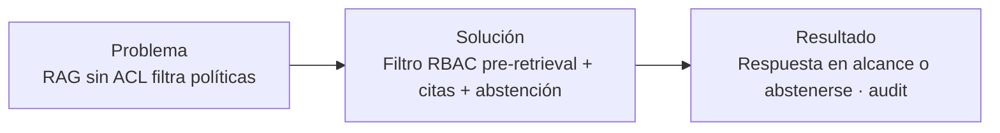

<div align="center">

# policy-rag-rbac

**RAG interno con control de acceso por rol** · Angel Salazar Lima · CIP 404730

</div>

---

## Problema

Un asistente de políticas que “responde bien” pero **sin permisos** puede filtrar crédito, fraude o PLD a roles que no deberían verlos. En entornos regulados eso es peor que no tener chatbot.



## Qué incluye (producto completo)

| Pieza | Ubicación |
|-------|-----------|
| Roles + ACL | `samples/roles.json`, `samples/acl.json` |
| 10 políticas sintéticas | `samples/policies/` |
| RAG léxico con filtro **antes** del ranking | `src/policy_rag_rbac/rag.py` |
| Eval grounded / abstain / rbac | `samples/asks.jsonl`, `experiment.py` |
| UI + audit log | FastAPI `:8024`, `data/audit.json` |
| Gates CI | `ci/thresholds.yaml` + `llm-ci-gates` |
| Docker / Compose | `Dockerfile`, `docker-compose.yml` |
| Docs | `docs/architecture.md`, `EXPERIMENT.md`, `CONCLUSIONS.md` |

## Roles

| Rol | Alcance (síntesis) |
|-----|--------------------|
| `analista_credito` | Límites, scoring, fraude |
| `soporte` | SOPs de atención + FAQ |
| `rrhh` | Vacaciones y altas/bajas |
| `auditor` | Lectura amplia (incl. PLD y logs) |
| `publico` | Solo FAQ de productos |

## Inicio rápido

```bash
pip install -e ".[dev]"
pytest -q
python -m policy_rag_rbac roles
python -m policy_rag_rbac ask --role soporte "¿Cuál es el límite comercial?"
python -m policy_rag_rbac ask --role analista_credito "¿Cuál es el límite comercial?"
python -m policy_rag_rbac experiment
python -m policy_rag_rbac serve
```

UI: http://127.0.0.1:8024

## Docker

```bash
docker compose up --build
```

## Endpoints

| Método | Ruta | Descripción |
|--------|------|-------------|
| GET | `/` | Consola con selector de rol |
| POST | `/ask` | Formulario `role` + `question` |
| GET | `/api/ask?q=&role=` | JSON |
| GET | `/api/roles` | Docs autorizados por rol |
| GET | `/api/stats` | KPIs de auditoría |
| GET | `/health` | Estado |

## Invariante

Toda cita ∈ documentos autorizados del rol. Si no hay evidencia en alcance → abstención, no invención.

## Licencia

MIT · datos 100% sintéticos · sin documentos reales de ninguna entidad.
