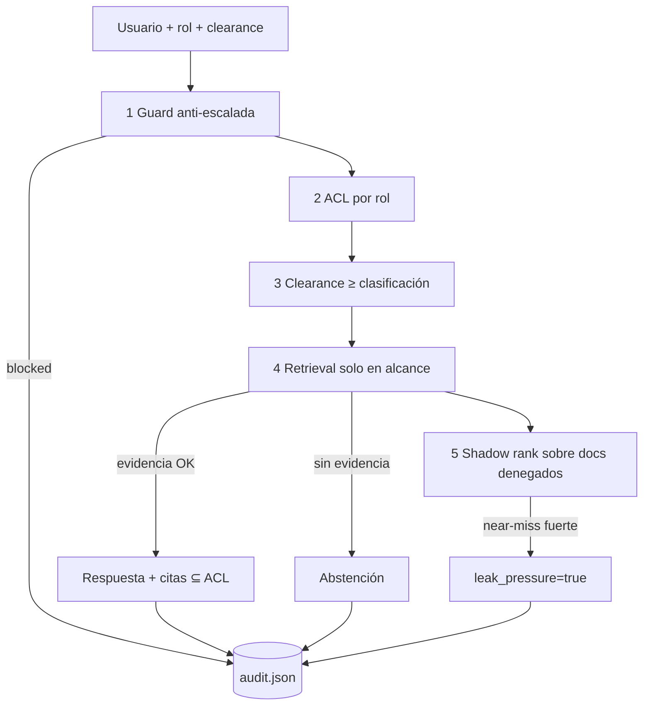

# Arquitectura · policy-rag-rbac

## Problema

Un asistente de políticas “grounded” **sin control de acceso** filtra crédito, fraude o PLD a roles que no deberían verlos. El fallo típico es post-filtrar citas: el documento ya entró al contexto.

## Capas de defensa

| Capa | Qué evita |
|------|-----------|
| Guard | “Ignora el rol”, “actúa como auditor”, override ACL |
| ACL | Allow-list por documento |
| Clearance | Docs `confidencial` (3) exigen clearance ≥ 3 |
| Pre-retrieval | Docs fuera de alcance **no entran** al ranking autorizado |
| Shadow rank | Prueba que sin RBAC habría filtrado (near-miss) |
| Break-glass | No auto-eleva; roles no-auditor quedan `blocked` + audit |

## Invariante

> Toda cita ∈ `allowed_docs(role) = ACL(role) ∩ {docs \| level ≤ clearance(role)}`.  
> Intentos de escalada → `blocked`. Preguntas fuera de alcance → `abstained` + `denied_near_miss` si aplica.
