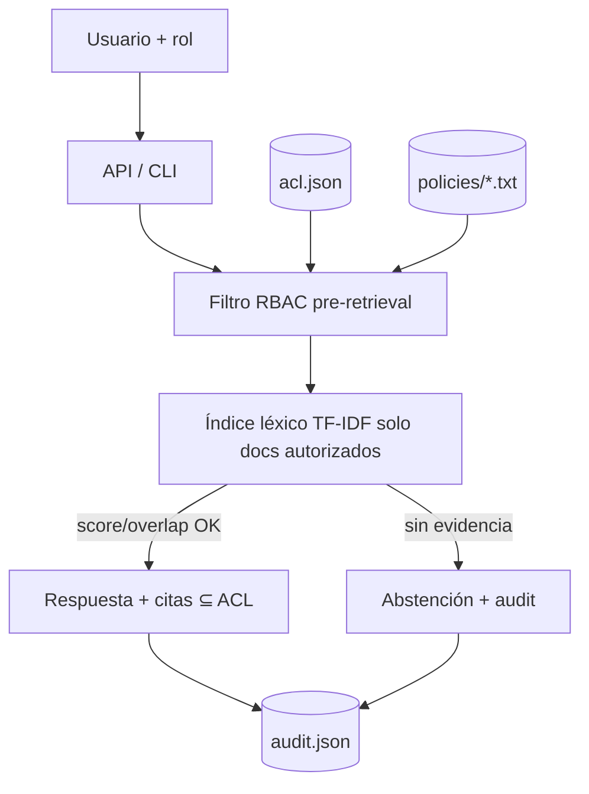

# Arquitectura · policy-rag-rbac

## Problema

En un asistente interno sobre políticas, el riesgo no es solo alucinar: es **filtrar** un documento que el rol del usuario no debería ver. Un RAG sin ACL responde “bien” y rompe confidencialidad.

## Diseño

## Piezas

| Módulo | Responsabilidad |
|--------|-----------------|
| `rbac.py` | Roles, ACL, docs permitidos por rol |
| `rag.py` | Retrieval **después** del filtro; defensa en profundidad en citas |
| `experiment.py` | Suites grounded / abstain / rbac (anti-filtración) |
| `app.py` | UI + `/api/ask?role=` + auditoría |
| `llm-ci-gates` | Barrera CI sobre `suite.rbac` |

## Invariante de seguridad

> Toda cita devuelta pertenece al conjunto `allowed_docs(role)`.  
> Preguntas fuera de alcance → `status=abstained`, `citations=[]`.

El filtro es **pre-retrieval** (no post-hoc): los documentos no autorizados ni siquiera entran al ranking.
